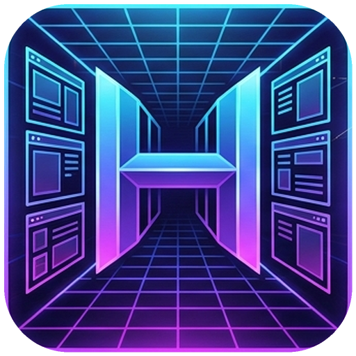

<picture>
  <source media="(prefers-color-scheme: dark)" srcset="docs/assets/hallwaywm-logo.png">
  
</picture>

# HallwayWM

Window placement and monitor-layout management for GNOME Wayland.

HallwayWM remembers where applications belong and keeps open windows organized when monitors connect, disconnect or switch through a KVM. One extension coordinates application rules, live window layouts, workspaces and asynchronous Wayland configuration.

## Features

- Persistent position, size, monitor and workspace rules for each application's main window.
- Per-session layouts for all normal open windows, including additional windows of the same application.
- Automatic display profiles identified by connected devices, screen arrangement and primary display.
- Named profiles, independent layout copies and linked templates with explicit screen mapping.
- Maximized, minimized, fullscreen, above and sticky state restoration.
- Workspace handling that respects GNOME's primary-monitor workspace policy.
- A **HallwayWM** submenu in the native window menu (`Alt+Space`) for rules and manual capture.
- Preferences with application overrides, global defaults, configuration import/export and an Active switch.
- Window-layout retention through screen locking, with restoration deferred until unlock.

Rules and captured application profiles remain private in the user's dconf database. Live window snapshots stay in memory and expire when their windows close or the extension is disabled. HallwayWM opens no applications.

## Display profiles

Open **Display Profiles** in preferences. The connected screens select their profile automatically. Give it a name, arrange applications and use **Save Positions**, or save an individual application from its rule. Saving in a notebook-only setup keeps its positions separate from a docked setup. Saved main-window positions are applied when that setup returns; the active workspace stays unchanged during profile switches.

**Save Positions** preserves each application's current lock setting. **Save & Lock** also stops automatic position learning for the applications successfully saved. Apps using Global Defaults receive individual rules with the same restore options; existing active rules keep their matching and restore settings. Locks apply to those applications across all display profiles, while saved positions remain separate per setup. Move windows freely during use, then use **Restore** or reopen an application to restore its saved position. Unlock an application's rule on the **Applications** page to resume learning. Explicit saves remain available while a rule is locked; apps excluded from defaults without an active individual rule and secondary windows are not included in either bulk action.

A new setup starts with the desktop's current placement. Under **Reuse a Saved Layout**, select another profile and choose:

- **Independent copy**: copy its saved positions, then edit the destination separately.
- **Linked to source**: follow the source's saved positions. Local automatic and manual saving are disabled while linked; **Make Independent** preserves the resolved layout and allows local editing.

Assign each source screen to a destination screen. Positions and sizes adapt proportionally to the destination's usable area. Copying replaces only the connected profile's saved positions. **Restore** reapplies the current profile to already-open main windows. Additional normal windows retain their own live KVM snapshots.

Device identity uses the monitor's vendor, product and serial information. A connector is used when a serial is missing or ambiguous; identical devices with no unique identification cannot always be distinguished across ports. Existing geometry-only records remain available as layout templates, and a matching connected setup adopts its existing saved positions.

## Application defaults

**Use Default Application Rules** covers main windows without an active individual rule. Each restore option recalls a saved value; for example, **Restore Maximized State** restores either maximized or normal state. **Restore Workspace** places the window on its saved workspace, while **Follow Window to Its Workspace** also activates that workspace when opening the application. The global Active switch controls all HallwayWM behavior.

## Build and install

The supported environment is GNOME Shell 51, Node.js 22 or newer, npm, Python 3 and `glib-compile-schemas`.

From this checkout:

```sh
npm ci --ignore-scripts --workspaces=false
npm run check
bash scripts/install.sh
```

The installer preserves private settings and copies generated JavaScript and assets as regular files. After the first installation, sign out and back in so GNOME discovers the extension, then enable it and open preferences:

```sh
gnome-extensions enable hallwaywm@workstation.local
gnome-extensions prefs hallwaywm@workstation.local
```

Sign out and back in after subsequent updates to load changed JavaScript.

`bash scripts/pack.sh` builds `temp/hallwaywm.zip`. Generated `dist/`, `node_modules/` and release archives stay outside Git. TypeScript is the maintained source.

See [operation, build validation and recovery](WORKSTATION.md) for the placement rules, session-layout lifecycle and isolated GNOME test matrix. The stable `org.gnome.shell.extensions.deja-window` settings schema preserves existing private rules and profiles.

## Credits and license

HallwayWM is derived from [Deja Window](https://github.com/ihpled/deja-window) and consolidates the open-window layout behavior of [Window State Manager](https://github.com/kishorviswanathan/window-state-manager). See [CREDITS.md](CREDITS.md) for their distinct contributions and project lineage.

The original Deja Window history and [GNU GPL version 3 license](LICENSE) are preserved.
